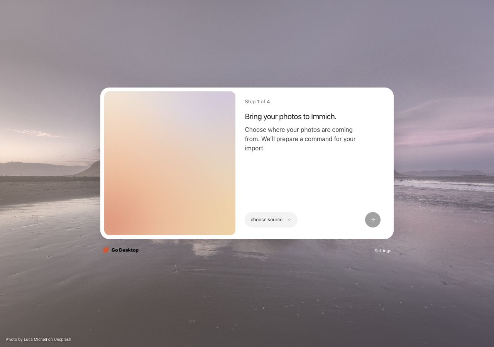

# immich-go-desktop

[](LICENSE)
[](https://blickoneblickytwo.github.io/immich-go-desktop/)
[](https://github.com/blickoneblickytwo/immich-go-desktop/stargazers)
[](https://github.com/simulot/immich-go)
[](https://github.com/immich-app/immich/releases/tag/v3.3.0)



**A visual way to prepare your immich-go import command.**

[Launch the App](https://blickoneblickytwo.github.io/immich-go-desktop/) · [Report a Bug](https://github.com/blickoneblickytwo/immich-go-desktop/issues) · [Request a Feature](https://github.com/blickoneblickytwo/immich-go-desktop/issues)

---

## Who is this for?

If you've ever opened a terminal to run an immich-go command and immediately felt lost - this is for you.

I built this while migrating my own photo library. The tool that does the actual importing (immich-go) is great, but figuring out the right command to run is a real barrier if you're not a developer. One wrong flag or a typo in your server URL and things go sideways fast.

This app removes all of that. You click through a few steps, it builds the command for you, and you paste it into your terminal and run it. That's it.

---

## How it works

1. Open the [live app](https://blickoneblickytwo.github.io/immich-go-desktop/) - nothing to install
2. Pick what you're importing (a folder, a Google Takeout, an iCloud export, or another Immich server)
3. Enter your Immich server URL - your API key is **optional** (there's a test button, or skip it and fill your key in later, in your own terminal)
4. Point it to your photos and choose how to handle them
5. Copy the generated command and paste it into your terminal

---

## What it does and doesn't do

This app **generates the command** for you. The actual importing is still done by immich-go running in your terminal - this just means you never have to write the command yourself.

It supports the main immich-go import sources:

- 📁 **A folder** on your computer
- 📦 **A Google Photos Takeout** (zip or extracted folder, with wildcard support)
- 🍎 **An Apple iCloud export**
- 🔁 **Another Immich server** — server-to-server migration

You'll need immich-go installed to run it. If you haven't installed it yet, follow the [immich-go installation guide](https://github.com/simulot/immich-go). This app targets **immich-go v0.32.0**. On October 8, 2026, its generated flags were checked against the upstream command documentation and its optional connection-test endpoint was checked against the **Immich v3.3.0** OpenAPI specification. No integration changes were indicated by those checks; a live photo import against v3.3.0 has not been tested. See [the verification baseline](IMMICH_GO_BASELINE.md) for the evidence and remaining binary-verification work.

The **Settings** link below the card opens Privacy, Help (API key permissions, reading immich-go's output), and About tabs.

### Optional Advanced controls

In step 3, choose **Custom → Advanced** for destination/source album options, burst and HEIC/JPEG stacking, a time-zone override, session tagging, concurrency, and request timeout. Only supported controls appear for each source. Advanced starts collapsed; unchanged defaults add no flags, and its overrides apply only to Custom.

Custom speed settings now affect concurrency: Slow uses 2 tasks, Fast uses 8, and Balanced leaves the choice to immich-go. An explicit concurrency value in Advanced takes precedence. Beginner presets keep their existing commands.

### Review an import log

After running immich-go separately, open **After you run it → Review an import log**, or **Settings → Help → Reading import results**. Select an existing UTF-8 text or JSON-lines log, up to 25 MiB, or try the clearly labelled synthetic sample.

The reader shows recognised summary counts and grouped warnings/errors. Missing counts stay unknown, appended runs are reviewed separately, and errors outside the asset summary remain visible. This is an interpretation of the log, not verification of your library or a guarantee that every photo imported. Recognition is checked against immich-go v0.32.0; other formats may be only partially understood. See [the log format contract](docs/log-format-contract.md).

Log contents are processed in a browser worker without being uploaded or saved by the app. Source excerpts can contain private information and remain collapsed. Clear log, return to the import wizard, or reload to discard the report from the view. Your original file stays unchanged. An unfinished wizard is preserved in page memory when you open the reader and return; reloading does not preserve that wizard state.

---

## How connection details are handled

- **Keys are optional.** Leave a key field blank and the command uses `YOUR_API_KEY` or `YOUR_SOURCE_API_KEY`, for you to replace outside this page.
- **The browser tests only the destination.** Clicking Test connection sends that key to the entered destination’s `/api/server/about` endpoint. The request blocks redirects, omits browser cookies and referrer information, and times out after 10 seconds. Use HTTPS: HTTP does not encrypt the key. A successful response does not prove that every import permission is available, and the source server is not tested.
- **Remember is optional.** With Remember selected, Continue or a successful test saves the destination URL and any destination key as plain text in this site’s browser storage. The app does not encrypt this storage; scripts on the same origin can read it. Migration source details and photo paths are not saved. Unchecking Remember or clearing the saved connection in Settings removes that stored record and turns Remember off; storage failures are reported. Already entered form values remain in page memory until reset or reload.
- **Exports include entered keys.** Copy command and Download as script include any keys you entered, even if the preview masks them. Clipboard history, script files, shell history, and running-process information can retain or expose those keys. Do not share them; use placeholders if you prefer to insert keys outside this page.
- **Page loading still uses the network.** This version has no analytics or application backend receiving form details. The host serves the page, JavaScript, stylesheet, and bundled image and may log ordinary request metadata. See [GitHub’s privacy statement](https://docs.github.com/en/site-policy/privacy-policies/github-general-privacy-statement). External help links open third-party sites. The connection test is an additional, optional request.
- **The app does not scan your photo library or upload photos.** The command builder produces text; the optional log reader reads only the file you select. immich-go performs the import separately on your computer. A test-run command skips photo uploads but still connects to your server.
- **Log review reads the file you explicitly choose.** Contents and the resulting report stay in page/worker memory, with no log upload or new browser persistence. Loading this optional view fetches its app code and worker from the host. Browser extensions and other same-origin scripts remain separate trust boundaries.

Inspect the source and your browser’s Network panel to check this version’s behavior, or [run it locally](#run-it-locally-optional). Local operation avoids loading the app from GitHub; connection tests and terminal imports still contact the server you specify. See [the privacy review](PRIVACY.md) for scope, safeguards, and remaining limits.

---

## Run it locally (optional)

You don't need to install anything to use the app - just open the link above. But if you want to run it offline:

```bash
git clone https://github.com/blickoneblickytwo/immich-go-desktop.git
cd immich-go-desktop
npm install
npm run dev
```

It's a frontend-only app built with Vite + React.

Use **Node.js 24 LTS** for local development. The development server listens on `127.0.0.1` by default.

The Tailwind CSS 4 build targets modern browsers: Safari 16.4+, Chrome 111+, and Firefox 128+.

---

## FAQ

**What API key permissions do I need?**
Use a scoped key and review the permissions for your immich-go version, source, and selected options. The baseline import set shown in **Settings → Help** is `asset.read`, `asset.statistics`, `asset.update`, `asset.upload`, `asset.copy`, `asset.delete`, `asset.download`, `album.create`, `album.read`, `albumAsset.create`, `server.about`, `stack.create`, `tag.asset`, `tag.create`, `user.read`. See [the upstream permission discussion](https://github.com/simulot/immich-go/discussions/1032). Add job permissions on an admin-linked key only if you choose to pause background jobs; generated commands set `--pause-immich-jobs=false`. The browser test checks the server-info endpoint, not the full permission set.

**What does "WARNING: N assets did not reach a final state" mean?**
Check the final immich-go summary, your library, and its log for missing assets before treating the import as complete. That warning is not proof of either success or failure.

---

## Recent Updates

Curious about the latest improvements (like the fully optional API key, the new Settings dialog, and a connection test that never blocks you)? Check out the [Changelog](CHANGELOG.md) for a full list of recent changes.

---

## Want to help?

This is a source-available project and contributions are welcome! A few areas where help would be especially appreciated:

- **Standalone desktop app** - wrapping this into a proper Mac/Windows/Linux app (Electron, Tauri, or similar) so users don't need to touch the terminal at all. If this sounds like something you could help with, please open an issue or reach out.
- **UI improvements and accessibility**
- **Support for more immich-go flags**
- **Testing across different setups**

Even if you just find a bug or have a feature idea, opening an issue is a huge help. Before contributing code, open an issue to agree on contribution licensing, including any permission needed for separate commercial licensing.

---

## License

This revision uses the [PolyForm Noncommercial License 1.0.0](LICENSE). Personal and other permitted noncommercial uses are free under those terms. The license also expressly permits uses by the noncommercial organizations it lists.

**Commercial use outside those permitted purposes requires a separate written commercial license before use.** This includes commercial applications, paid hosting or migration services, and internal business use that is outside the license's permitted purposes. [Contact blickoneblickytwo on GitHub](https://github.com/blickoneblickytwo/immich-go-desktop/issues/new?template=commercial-license.yml) to discuss permission. Opening an issue does not itself grant permission.

This is **source-available**, rather than OSI-approved open source. See [commercial licensing and license history](COMMERCIAL-LICENSE.md) for details. Existing MIT grants remain valid; the [previous MIT notice](LICENSES/MIT-legacy.txt) is retained for previously MIT-licensed material. Third-party components, including immich-go, retain their own licenses.
