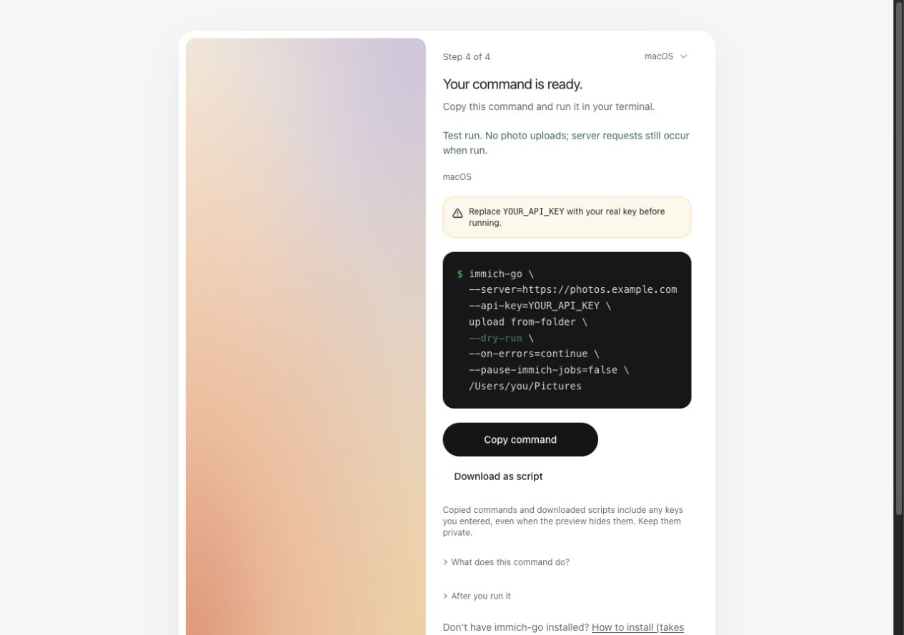

# Go Desktop · immich-go-desktop

[](LICENSE)
[](https://blickoneblickytwo.github.io/immich-go-desktop/)
[](IMMICH_GO_BASELINE.md)

**Prepare an immich-go import command in four simple steps.** Bring a photo folder, Google Photos Takeout, Apple iCloud export, or another Immich library into your own Immich server.

[Open the app](https://blickoneblickytwo.github.io/immich-go-desktop/) · [Report a problem or suggest a feature](https://github.com/blickoneblickytwo/immich-go-desktop/issues) · [What's new](CHANGELOG.md)

The app builds a command for you to run in a terminal. **It does not upload your photos or run immich-go itself.** Despite the project name, this is currently a browser app; a standalone desktop package is not included.

> Screenshots show the revision in this repository. The hosted app may differ until that revision is deployed. All screenshots use example details; the log sample is synthetic.

## Before you start

Have these three things ready:

- **Your Immich server address**, such as `https://photos.example.com`.
- **Your photos or export**, accessible from the computer that will run the command. For a server-to-server move, have the source server address and its API key instead.
- **immich-go v0.32.0**, installed on that computer. Follow the [official installation guide](https://github.com/simulot/immich-go/blob/v0.32.0/docs/installation.md), then run `immich-go version` to check it.

A terminal is the command window on your computer: Terminal on macOS/Linux or PowerShell on Windows. Your Immich API key is needed when running the command, but you can leave it out of this page and add it yourself later. **Settings → Help** explains where to create a key and which permissions to review.

## Your first import, screen by screen

Start with **Test run**. It skips photo uploads but still contacts your server when you run it.

### 1. Choose where your photos are coming from

Open **choose source** and select a photo folder, Google Photos Takeout, Apple iCloud export, or another Immich server. Press the arrow to continue.


### 2. Enter your Immich server address

Use your own server address. Paste your API key if you want, or leave it blank to add it to the command later. **Test connection** is optional; you can continue without it. Leave **Remember on this device** off if you do not want the destination details saved in this browser.


For **Another Immich server**, this step also asks for the source server details. The browser connection test checks only the destination.

### 3. Add your photo path and choose Test run

Enter the full path to the folder or export **on the computer where immich-go will run**. This is a path field, not a photo upload. On macOS, dragging a folder into Terminal can help you find its path. For Takeout, use the path to your export ZIP files or extracted folder.

Check the operating-system selector, keep **Test run** selected, then choose **Generate command**. The options vary with your source; you can leave **Custom** alone for your first attempt. Server-to-server moves do not need a local photo path.


### 4. Copy the command and run it

Choose **Copy command**, then paste it into your terminal on the computer with immich-go installed. If you left a key blank, replace `YOUR_API_KEY` with your real destination key before running it. Server-to-server moves may also need `YOUR_SOURCE_API_KEY` replaced. Replace example addresses and paths with your own.



You can also choose **Download as script**. Copy and download both include any keys you entered, even if the preview hides them. Keep the command and script private.

**After the test:** read the terminal output and check for errors. When you are ready to upload, use **Back** to choose an upload preset and generate a new command. The test command will keep acting as a test if you run it again. Keep your original photos and export files while you check the result in Immich.

## Optional: more control with Advanced

In step 3, choose **Custom**, then open **Advanced**. It starts collapsed and adds no required step.

- Choose a destination album for folder imports, or filter a Takeout import to one named source album.
- Group burst or matching HEIC/JPEG photos into stacks for folder and Takeout imports. The exposed stacking choices keep both versions.
- Set a time-zone override, add a session tag, or adjust concurrency and request timeout.

**Slow** uses 2 concurrent tasks, **Fast** uses 8, and **Balanced** lets immich-go choose. An explicit **Concurrent tasks** value overrides the speed setting. Advanced overrides apply only while Custom is selected; **Reset Advanced** clears them. This is a selected set of CLI options, not every option immich-go supports.

For server-to-server moves, the timeout controls destination requests. The source server has a separate timeout that this UI does not expose.

<details>
<summary>See the Advanced screen</summary>


</details>

## Optional: understand an import log

After running immich-go, open **After you run it → Review an import log**, or **Settings → Help → Reading import results → Review an import log**. Choose an existing UTF-8 text or JSON-lines log, up to 25 MiB. **Try a sample log** lets you explore using clearly labelled example data.

The reader shows reported uploads, skipped/discarded assets, asset errors, and pending assets, plus grouped warnings and errors. Missing counts stay **Unknown**. It flags partial logs and conflicting summaries, and keeps appended runs separate. **These are reported counts, not a check that your Immich library is complete.**

<details>
<summary>See log selection and a sample report</summary>


</details>

Log contents are processed in browser memory and are not uploaded or saved by the app. Logs can contain credentials and private paths; source excerpts start collapsed. **Clear log**, return to the wizard, or reload to discard the report from the view. The original file is unchanged. Returning to the wizard keeps your unfinished form in page memory; a reload does not preserve that form.

Recognition is based on immich-go v0.32.0. Other formats may be only partially understood. See the [log format contract](docs/log-format-contract.md).

## Settings and privacy

**Settings** is below the main card. **Privacy** explains data handling and lets you clear a saved connection. **Help** covers API keys and import results. **About** includes version and licensing information.

<details>
<summary>See Settings</summary>


</details>

- **Connection testing sends your destination key to the address you enter.** Use HTTPS. The test blocks redirects and does not verify all import permissions; an unreachable browser test does not necessarily mean immich-go cannot reach your server.
- **Remember is optional and unencrypted.** Continue or a successful test saves the destination address and any destination key as plain text in this site's browser storage when Remember is on. Scripts on the same origin can read it. Source-server details and photo paths are not saved.
- **Copied commands and scripts contain entered keys.** Clipboard history, saved files, shell history, and process information may retain them. Using placeholders lets you add keys outside this page.
- **The host serves the app and may log request metadata.** This version has no analytics or application backend receiving form details. External help links open third-party sites. The app does not scan your photo library or upload photos; the optional reader reads only the file you choose.

See [PRIVACY.md](PRIVACY.md) for the complete data flow and limits, including clearing saved details, browser extensions, and log processing. You can also [run the app locally](#run-it-locally-optional).

## Compatibility

The latest official immich-go release was **v0.32.0** when checked on **October 17, 2026**. All exposed Advanced flags were checked against the checksum-verified official macOS ARM64 binary and tagged source. The four source commands' sanitized help captures and 18 help-only flag-parsing checks are recorded in [the verification baseline](IMMICH_GO_BASELINE.md).

Those checks confirm flag registration and parsing; **a real photo import and native Windows execution have not been tested**. The optional connection-test endpoint was separately checked against the Immich v3.3.0 API specification on October 8, 2026. That is an API-specification check, not a full integration guarantee.

## Run it locally (optional)

Use **Node.js 24 LTS** and npm. To work on this repository:

```bash
git clone https://github.com/blickoneblickytwo/immich-go-desktop.git
cd immich-go-desktop
npm ci
npm run dev
```

Open `http://127.0.0.1:8080/`. The server listens on this computer only by default. Cloning uses the repository's default branch; select the revision you want before installing dependencies if you are reviewing an unreleased change.

Local operation avoids loading the app from GitHub Pages. Installing dependencies needs internet access; connection tests and terminal imports still contact your chosen server.

This is a Vite + React frontend. Its Tailwind CSS 4 build targets Safari 16.4+, Chrome 111+, and Firefox 128+. For development checks:

```bash
npm test
npm run lint
npx tsc --noEmit -p tsconfig.app.json
npm run build
```

## Common questions

**Do I still need immich-go?**

Yes. This page prepares the command; immich-go runs it separately in your terminal.

**Where should I put my photos?**

Somewhere accessible to the computer running immich-go. The path you type must make sense on that computer, even if you opened this page on a different device. For Google Takeout, see the [upstream Takeout guide](https://github.com/simulot/immich-go/blob/v0.32.0/docs/commands/upload.md#from-google-photos).

**Which API key permissions do I need?**

Review **Settings → Help** and the [upstream permission discussion](https://github.com/simulot/immich-go/discussions/1032) for your version and selected options. Generated commands set `--pause-immich-jobs=false`. The browser connection test checks only server information, not the full import permission set. Avoid sharing API keys in issues or screenshots.

**What if the browser connection test fails?**

Double-check the address, HTTPS setup, key, and browser access. You can continue without the test and run the generated test command from the computer that can reach your server. Do not treat the browser result alone as proof of import compatibility.

**What does “assets did not reach a final state” mean?**

The run needs review. Check the final summary, log, and Immich library before calling it complete. Log review can help you find issues, but does not prove success or failure on its own.

## Contributing

[Open an issue](https://github.com/blickoneblickytwo/immich-go-desktop/issues) for bugs, feature ideas, accessibility feedback, or testing results. Useful reports include your source type, OS/shell, and immich-go version. Remove keys, private addresses, and personal paths from anything you share.

Before contributing code, open an issue to agree on contribution licensing, including any permission needed for separate commercial licensing. Standalone desktop packaging and testing across more setups are welcome areas for contributions. See the [changelog](CHANGELOG.md) for recent work.

## License

This revision uses the [PolyForm Noncommercial License 1.0.0](LICENSE). Personal and other permitted noncommercial uses are free under those terms. The license also expressly permits uses by the noncommercial organizations it lists.

**Commercial use outside those permitted purposes requires a separate written commercial license before use.** This includes commercial applications, paid hosting or migration services, and internal business use that is outside the license's permitted purposes. [Contact blickoneblickytwo on GitHub](https://github.com/blickoneblickytwo/immich-go-desktop/issues/new?template=commercial-license.yml) to discuss permission. Opening an issue does not itself grant permission.

This is **source-available**, rather than OSI-approved open source. See [commercial licensing and license history](COMMERCIAL-LICENSE.md) for details. Existing MIT grants remain valid; the [previous MIT notice](LICENSES/MIT-legacy.txt) is retained for previously MIT-licensed material. Third-party components, including immich-go, retain their own licenses.
